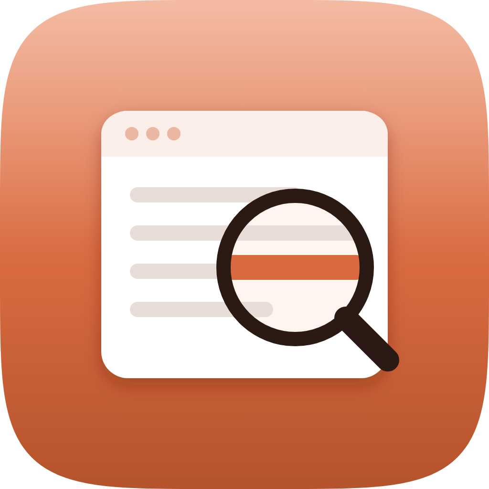
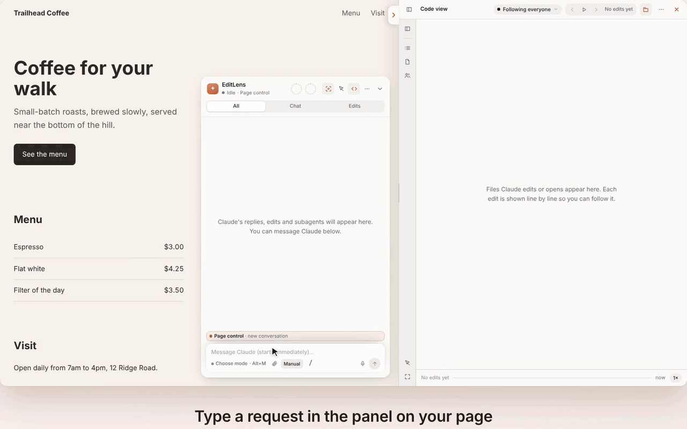

<p align="center"></p>

<h1 align="center">EditLens</h1>

<p align="center">See each change Claude makes to your website, live. A plugin for Claude Code.</p>

<p align="center"><a href="https://www.claudepluginhub.com/plugins/mymotomaker-ai-editlens?ref=badge"></a> <a href="https://hol.org/registry/plugins/mymotomaker-ai%2Feditlens"></a></p>



EditLens is a plugin for Claude Code. When Claude changes the code of your website, EditLens shows each change on the website in your browser as it happens. You see what Claude did without reading the code.

## What it does

- **Highlights each change.** The part of the page that changed is highlighted. EditLens also shows the file and line that changed.
- **Shows Claude's chat on the page.** A panel on the page shows Claude's replies and each step Claude takes.
- **Shows the code beside the page.** You see each change in the code, line by line. You can show any change again later.
- **Sends messages from the page.** Select a part of the page, type a note, and send it to Claude. Claude gets the part you selected and its code.
- **Lets you use Claude from the page.** Type instructions to Claude in the panel, as in Claude Code. This is called *page control*.

Works with most websites you build on your computer, such as Vite, Next.js, Express, or plain HTML. You don't need to change your project.

New to these words? See [Terms](docs/terms.md).

## Requirements

- Claude Code 2.1.287 or later (2.1.286 or later in the desktop app)
- Node.js 18 or later
- Windows, macOS, or Linux

## Install

In Claude Code, enter:

```
/plugin marketplace add mymotomaker-ai/editlens
/plugin install editlens@editlens
```

Then restart Claude Code.

## Get started

1. Open Claude Code in your app's folder.
2. Enter `/editlens`.
3. Open the address that EditLens shows.

Ask Claude for a change. The page highlights each change, and the panel shows the chat.

**No app yet?** Create an empty folder, open Claude Code there, and enter `/editlens new`. EditLens creates a starter
page and connects it.

## Examples

Type these in Claude Code, or in the panel on your page:

1. "Make the header sticky and give the buttons rounded corners."
   Each change is highlighted on the page as Claude makes it.
2. "Highlight every button on this page that has no label for screen readers, and show me the code for the first one."
   Claude outlines the buttons on the page and opens the code in the code view.
3. Select the arrow button in the panel, then the pricing card, and type "Make this card match the others."
   Claude gets the part you selected and the lines of code that create it.

## Commands

| Command | What it does |
| --- | --- |
| `/editlens` | Connects your page and turns on page control |
| `/editlens 3000` | Connects the dev server on port 3000 |
| `/editlens new` | Creates a starter page in an empty folder and connects it |
| `/editlens stop` | Disconnects and stops page control |
| `/editlens manual` | Switches to Manual: you use Claude in Claude Code only |
| `/editlens settings` | Opens the settings |
| `/editlens status` | Shows what is connected |
| `/editlens help` | Lists all commands |

All commands: [docs/commands.md](docs/commands.md).

## Documentation

| Page | What it covers |
| --- | --- |
| [Terms](docs/terms.md) | The words EditLens uses, in plain English |
| [Connect your page](docs/connect-your-page.md) | Vite, plain sites, other dev servers, and adding EditLens yourself |
| [The panel](docs/panel.md) | Chat, change cards, code view, replay, usage, and commands |
| [Page control](docs/page-control.md) | Use Claude from the page, sign in, and permission modes |
| [Select things on the page](docs/pick-box.md) | Send a part of the page and a note to Claude |
| [Dictation](docs/dictation.md) | Speak your messages instead of typing |
| [Subagents](docs/subagents.md) | The Agents switcher, separate copies, and the team board |
| [Pairing](docs/pairing.md) | Use Claude on another computer |
| [Settings](docs/settings.md) | Every setting and its default |
| [How it works](docs/how-it-works.md) | Hooks, the local server, and the page script |
| [Install and update](docs/updating.md) | Update steps and fixes for Windows |
| [Security](docs/security.md) | Who can connect, and who can allow Claude's actions |

## What EditLens runs and reads

- **Session transcript.** EditLens reads each Claude Code session's transcript file in `~/.claude/projects` to show
  the chat on the page.
- **Hooks.** The hooks send Claude's events (prompts, changes, tool steps, agents, and permission questions) to the
  local server. They also:
  - add a short note to Claude's context when a session starts;
  - in a git project, run each subagent that changes files in its own worktree (the `PreToolUse` hook adds
    `isolation: "worktree"` to the subagent's call and approves nothing);
  - block Claude from calling EditLens's own approval addresses.

  They never answer permission questions.
- **Local server.** `node server/server.js` uses `127.0.0.1:4317`. Only when you ask, it also opens an address for
  your dev server, the pairing port 4318, and, for a paired computer, a local port for its page and an `ssh`
  connection.
- **Your app.** `/editlens` runs your project's own Vite with EditLens added, or shows a plain site's folder. It runs
  no other script of yours. It can open your browser.
- **Claude Code mod.** `hooks/mod.mjs` shows the line above the prompt, the `/editlens` output, and the Settings pane.
  - It connects only to the local server on `127.0.0.1`, with the server's key. It sends settings and finished tool
    calls, and gets the summary.
  - It changes only EditLens's own settings (`editlens.*`), when you change one in its Settings pane, in the page's
    Settings, or with `/editlens line`.
  - It writes the session's port to `~/.claude/editlens/session-ports`.
  - It runs `node bin/start.js` for `/editlens`, `node bin/serve.js` to start the server, and Claude Code's `/effort`
    when you select the effort button.
  - It can put text in the prompt box, but never sends it. It never answers permission questions and never changes
    Claude Code's permission mode.
- **MCP server.** `node mcp/live-page.js` gives Claude 26 tools. Each tool says whether it only reads.
- **git.** EditLens adds and removes worktrees for subagents, and reads status, diffs, and history.
- **npm.** The first time page control starts, EditLens installs `@anthropic-ai/claude-agent-sdk` into
  `~/.claude/editlens`. Page control and tasks run Claude through it, with your own Claude login. Sign-in uses
  `claude auth status` and `claude auth login`.
- **Task account.** Only when you enter `/editlens task-user` (Linux, as root): EditLens creates a normal `editlens`
  account, and then runs Claude Code's official installer as that user:
  `curl -fsSL https://claude.ai/install.sh | bash`.
- **Files it reads.** Claude Code's settings files (it never changes them), and files in the project Claude works in,
  for the code view and the change cards. It never reads hidden files or password and key files.
- **Files it writes.** Only files in `~/.claude/editlens`, and EditLens lines in your files when connecting needs them.
  `/editlens stop remove` removes those lines.
- **Network.** Nothing goes to the author. See [Privacy](#privacy).

## Privacy

EditLens collects nothing and sends nothing to its author. Data leaves your computer only in these cases:

- the one-time page control install;
- Claude's own connection to Anthropic;
- a pairing connection that you start;
- online dictation, if you turn it on.

See [PRIVACY.md](PRIVACY.md).

## Security

Only your own computer can connect to the EditLens server (`127.0.0.1`). See [docs/security.md](docs/security.md). To
report a security problem, follow [SECURITY.md](SECURITY.md).

## Troubleshooting

- **The page doesn't connect.** Enter `/editlens status`. Open the address that `/editlens` showed, not your dev
  server's own address. If EditLens didn't find your dev server, enter its port, for example `/editlens 3000`.
- **The port is in use.** Choose another **Port** in `/editlens settings`, and then enter `/editlens restart`.
- **The page shows an old version.** Restart Claude Code, and then enter `/editlens restart`.
- **Page control doesn't start.** Sign in when the panel asks you to. Page control needs Node.js 18 or later and npm.
- **Something else.** [Open an issue](https://github.com/mymotomaker-ai/editlens/issues/new/choose) and attach the logs
  `~/.claude/editlens/server-4317.log` and `~/.claude/editlens/hooks.log`.

## Support

- Questions and bugs: [open an issue](https://github.com/mymotomaker-ai/editlens/issues/new/choose).
- Security problems: report them privately, as [SECURITY.md](SECURITY.md) describes.
- Email: mymotomaker@gmail.com

EditLens has no website or domain. The GitHub repository is the only official source.

## Contributing

Bug reports and pull requests are welcome. See [CONTRIBUTING.md](CONTRIBUTING.md).

## License

EditLens is released under the [MIT License](LICENSE).
