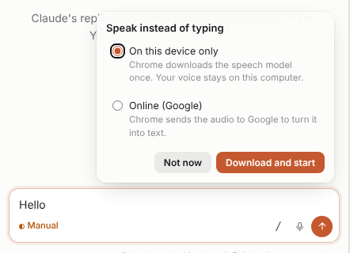
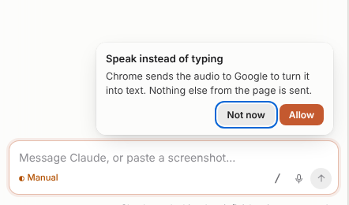
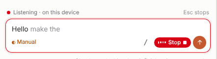
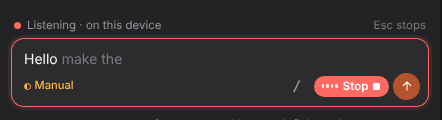
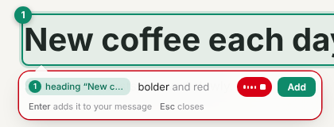
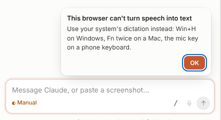
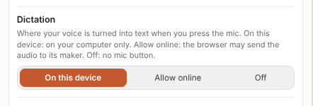

# Dictation: speak instead of typing

You can speak your message instead of typing it. Your browser turns your voice into text.

The panel's message box and the box next to a pick have a **mic** button. Select it, or press **Ctrl+Shift+Space**
in the box, and speak. Nothing is sent by itself. You read the text, change it if needed, and select **Send**.

## Step 1. Press the mic and choose where your voice goes

The first time, a card asks where your voice is turned into text.

- **On this device only** (default): your voice stays on your computer. Chrome downloads its speech
  model once. The button shows **Download and start**.
- **Online**: the browser sends the audio to its maker (Google for Chrome) to turn it into text.

Edge and Safari work online only. Their card says where the audio goes, and that nothing else
from the page is sent. Select **Allow** to continue.

The browser then asks one time for access to the microphone.

## Step 2. Speak

The box gets a red ring, the mic becomes a red **Stop** button, and a line above the box shows
**Listening · on this device** (or **online**). Words that the browser isn't sure of yet are grey. They turn
black when the browser is sure. The words are added at the cursor and never replace what you typed. You can keep
typing while it listens.

## Step 3. Stop

Dictation stops when you press **Esc**, select **Stop** or **Send**, or say nothing for one minute. **Send**
never sends the grey words.

## In the box next to a pick

The box next to a pick has its own mic, before **Add**. **Esc** stops listening and keeps the box open.
**Add** (or Enter) puts the note in the panel's message box, without the grey words.

## When there is no mic

The mic is grey. Select it to see why:

- **Firefox** (and some other browsers) can't turn speech into text.
- **A plain IP address** (http://192.168…) isn't a secure page. Open the page on localhost, or
  through the SSH tunnel that `/editlens` shows.
- **The microphone is blocked** for the page, or the site's Permissions-Policy turns it off. Allow it
  in the address bar.

Your computer's own dictation always works in both boxes: **Win+H** on Windows, **Fn** twice on a Mac,
the mic key on a phone keyboard. In Claude Code's terminal, `/voice` does the same.

## The setting

Settings > **Dictation** (or `/config`, search "editlens"):

- **On this device** (default): only where the browser can do it on your computer.
- **Allow online**: the browser may send the audio to its maker.
- **Off**: no mic button.

