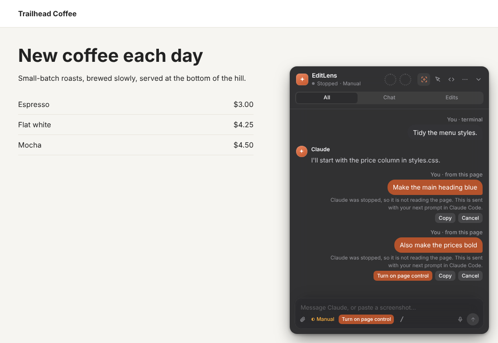

# How it works

EditLens has three parts:

1. **Hooks:** small scripts that Claude Code runs at fixed moments, for example before and after each change. They
   send what Claude does to the local server.
2. **Local server:** a small program on your computer (`127.0.0.1:4317`). It sends each event to your page.
3. **Page script** (`live.js`): runs in your page. It highlights the changes and shows the panel.

```
Claude Code hooks ──POST──▶ local server (127.0.0.1:4317) ──SSE──▶ live.js in your page
 SessionStart      start the server               │                 • highlight changed elements
 UserPromptSubmit  task + deliver page messages   ├─ follows the     • chat: replies, steps, prompts
 PreToolUse        file before the edit           │  session         • subagent cards
 PostToolUse       file after, diff, routes       │  transcript      • edit cards with diffs
 Stop              send page messages; wait       ├─ keeps code      • message box
live-page MCP tool ──POST── highlight_on_page ────┤  snapshots ─GET─▶ • Claude's highlights
                            show_code ────────────┘                  • split-screen code view + replay
```

- **Replies and subagents.** The server reads the session's transcript file as it grows, and each subagent's
  transcript next to it. Every reply, tool step and subagent result is shown on the page as soon as
  Claude Code writes it.

- **Finding what changed on the page.** The page script watches the DOM. When an edit is saved, your
  dev server's hot reload updates the page, and the elements that actually changed are the ones that
  are highlighted. For stylesheet edits, which don't change the DOM, it highlights the elements matching the
  edited rule's selector (`.button`, `.stats`). If that finds nothing, it uses ids and text taken
  from the diff.
- **Code view.** The PreToolUse hook sends the file as it is before each edit, and PostToolUse sends it
  after. The server keeps both (the last 80 edits, up to 512 KB per file) out of the event stream; the
  page gets them when it shows the edit, and diffs them to type the change out line by line. Short
  edits are typed character by character; long ones appear a line at a time; very large ones are shown
  finished with the changed lines marked.
- **Intent.** The hook reads the session transcript and attaches the sentence Claude wrote just
  before that exact tool call. On session start the plugin asks Claude to say in one sentence what it
  is about to change, so the captions stay useful.
- **Messages from the page** wait on the local server until Claude can read them. Claude Code lets a plugin give
  Claude a message only at fixed moments, so when Claude gets your message depends on what Claude is doing:
  - **Claude is working:** Claude gets your message when it finishes its current turn, and continues. Messages are
    not added in the middle of a turn, because Claude ignores instructions that appear inside tool output.
  - **Claude has just finished:** if **Wait** is on in the panel (it is off by default), Claude waits up to 5
    minutes for a message from the page and answers it immediately. To stop waiting early, press Esc in the
    terminal or turn Wait off. Only local terminal sessions wait. Remote Control, the desktop and web apps, and the
    SDK never wait. To change this, set `EDITLENS_WAIT_ANYWHERE=1`.
  - **Claude is not working, was stopped, or Claude Code is closed:** the message is sent with your next prompt in
    Claude Code. The panel shows this under the message, with three buttons: **Turn on page control** (copies
    `/editlens control`, so Claude reads every message immediately), **Copy** (to paste the message into Claude
    Code yourself), and **Cancel** (Claude never gets it).
  - Claude Code's [channels](https://code.claude.com/docs/en/channels) could send a message into an open session,
    but they are a research preview, need a startup flag in a terminal, and can't be turned on in the desktop app
    or Remote Control. EditLens doesn't use them yet.

  
- **Backend edits.** A file counts as backend code based on its folder, its extension, or whether it
  creates a server. The plugin finds the routes the change touches: the handler it is in, or the
  routes that use the data it changed. The page script records which API calls filled which elements,
  so it can link the two. When the page uses a changed route, it waits for your server to respond to that
  route again, reloads, and outlines the refreshed elements in blue. Set `data-reload="off"` to skip
  the reload.
- **Pages without hot reload.** On a plain static page the script applies the change itself. Edited
  stylesheets are replaced without a reload. When the current HTML page is edited, only the parts whose source
  changed are updated in the live page, and they are highlighted. Content your scripts rendered, such as a list
  filled from an API, is not changed. Script edits reload the page, and the highlight is
  shown again after it.
