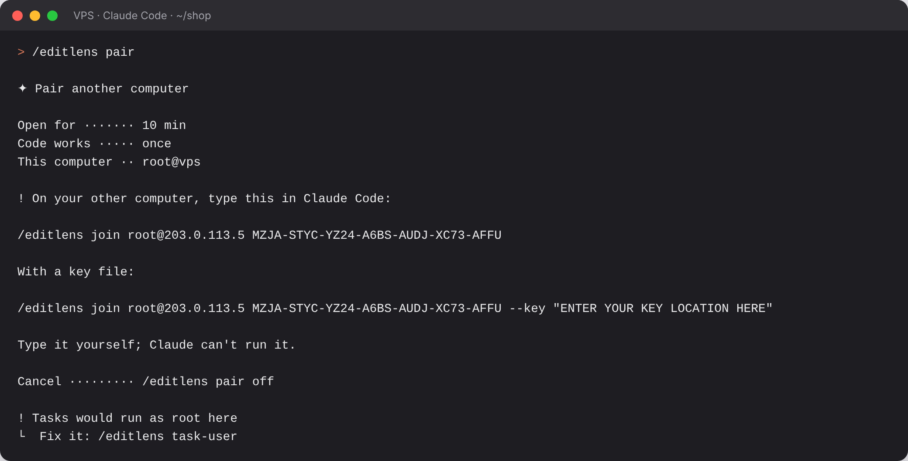
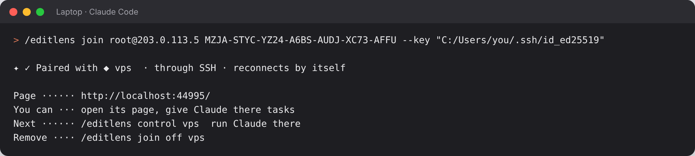
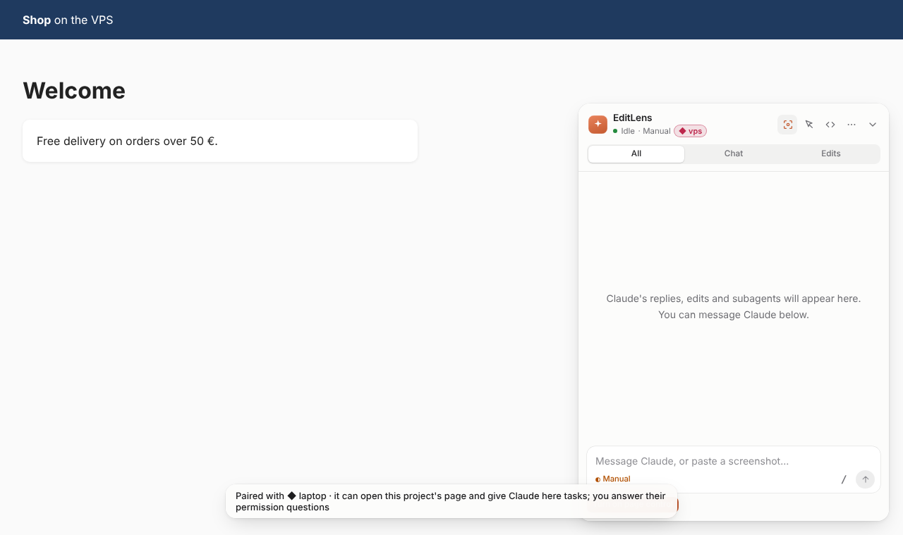
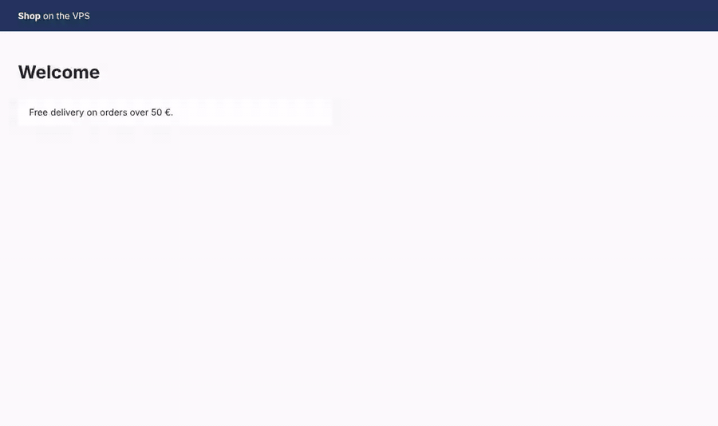
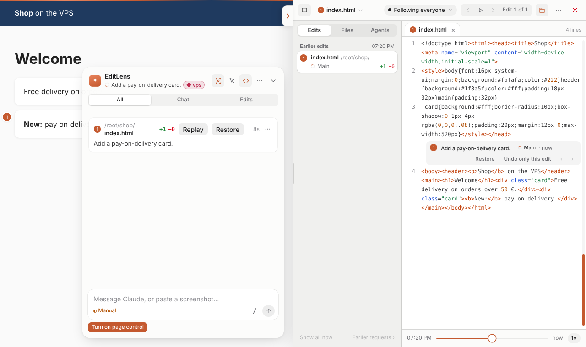
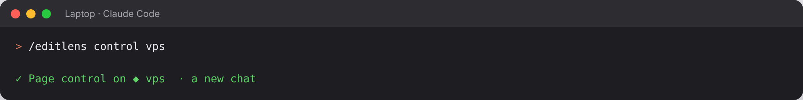
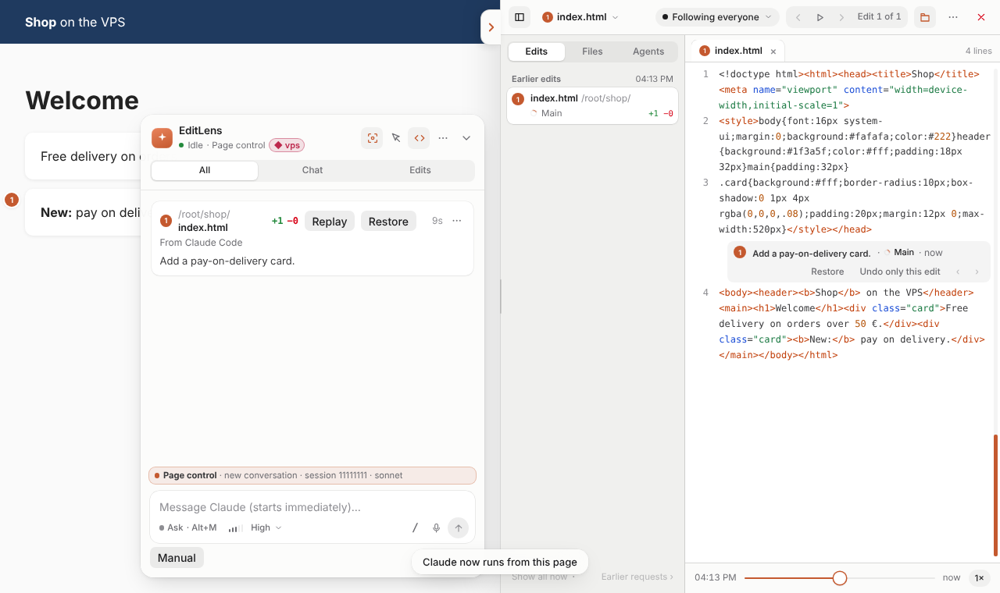
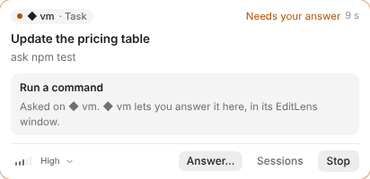
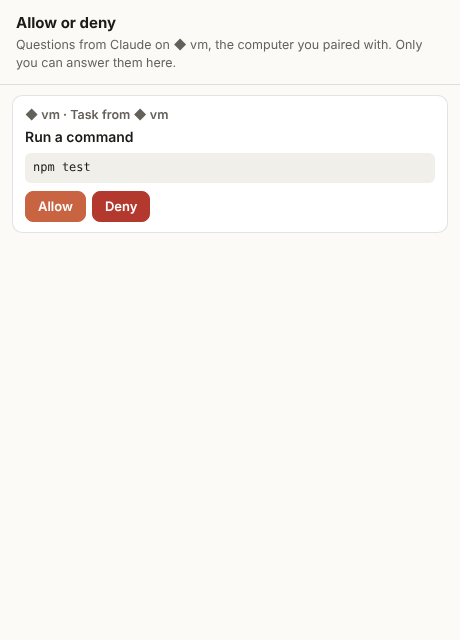

# Pairing: see and control Claude on another computer

Pairing connects EditLens on two computers. For example, Claude Code runs on a VPS and you want to
see its edits and use its panel on your laptop.

- The computer you want to **control** (here the VPS) runs `/editlens pair`.
- The computer you **work on** (here the laptop) runs the `/editlens join …` line that it prints.

Both commands are typed in Claude Code: in the chat of the Claude desktop app or in the terminal.
There is no account and no server in between. The two computers connect directly, through SSH and
an encrypted link.

**What you need:** EditLens installed on both computers, and an SSH key login from the laptop to
the VPS (EditLens can't type a password).

## Step 1. On the VPS: `/editlens pair`

Open Claude Code in your project on the VPS and type `/editlens pair`. It prints the line to type on
the laptop, with a one-time code. The second line is the same with `--key`, for a key file that ssh
doesn't use by itself.



The code works once and expires after 10 minutes. `/editlens pair off` cancels it, but it also removes
every pairing this computer has and closes the pairing port. To remove one computer only, type
`/editlens join off <name>` on the laptop.

## Step 2. On the laptop: `/editlens join …`

Copy the printed line into Claude Code on the laptop and press Enter. With a key file, use the second
line and put its path in the quotes, for example
`--key "C:/Users/you/.ssh/id_ed25519"`.



Type it yourself. Claude can't run it for you: Claude Code's auto mode blocks this on purpose,
because it opens a connection to another computer. Add `--ssh-port <n>` when SSH isn't on port 22.

## Step 3. The VPS's page opens on the laptop

The laptop opens the VPS's site in your browser, with the EditLens panel. The colored **◆ vps** label
in the panel header shows which computer the page and its Claude run on.

The address it opens has your key in it (`?editlens-key=…`). Your browser keeps a cookie from that
first visit, so later the plain address works. In another browser, open the address `/editlens join`
shows.



## Step 4. Edits on the VPS appear live on the laptop

Each edit Claude makes on the VPS appears on the laptop's page as it happens: the page reloads, the
changed part is highlighted, and the code view shows the change. Restore and Undo work from here.





## Step 5. Run Claude on the VPS from the page: `/editlens control vps`

To send messages to Claude on the VPS from the laptop's panel, type `/editlens control vps` in Claude
Code on the laptop. It opens the paired page in your browser and waits for it. When the laptop has
no browser that EditLens can open, it prints the page's address: page control starts when you open
it. `/editlens manual vps` switches back.



The panel then shows **Page control**, and what you type in it goes to Claude on the VPS. Permission
questions appear in the panel, and **Deny** works right on the card. Allowing happens in the
EditLens window on the VPS itself (`http://127.0.0.1:4317/answer` there), unless you turn on the
setting in Step 6. The page itself can never allow.



If Claude already runs from the page in another project on the VPS, `/editlens control vps take`
moves it to the paired project.

## Step 6 (optional). Answer the VPS's questions on the laptop

Off by default. When it is on, the laptop can allow or deny Claude's permission questions on the VPS
in the VPS's own EditLens window, opened through the pairing link.

1. On the VPS, type `/editlens settings` and press **Can answer here** (under Other computers) twice,
   or turn on "Paired computers can answer questions here" in `/config`. Only the VPS can turn it on:
   the laptop, its page and Claude can't.
2. On the laptop, a task card that waits for an answer now says "◆ vps lets you answer it here" and
   has **Answer…**. On the paired page, **Allow…** opens the same window.

   

3. The window says which computer asked. Only a person clicking in it answers.

   

It covers questions from page control in the paired folder and from tasks the laptop gave. Changing
the VPS's settings, Root (unsafe) and permission modes are still answered on the VPS only. Turning
the setting off, or unpairing, closes the window's access immediately.

## Give Claude on the VPS tasks

Once paired, Claude on the laptop can give work to Claude on the VPS. Just ask it, for example
"on the VPS, update the dependencies and run the tests". It has these tools:

| Tool | What it does |
| --- | --- |
| `list_paired_computers` | The paired computers, whether each is connected, and the project there |
| `start_task_on_computer` | Starts Claude there with a prompt, in its own workspace: on a copy of **this** project (`workspace: "mine"`, sent with the task) or on that computer's own project (`"theirs"`) |
| `check_computer_task` | Its state, new replies and result; can wait while it works (the other computer responds when the task changes, so waiting costs one request per change) |
| `message_computer_task` | A follow-up in the same conversation |
| `stop_computer_task` | Stops it |
| `merge_computer_task` | Copies the workspace's changes into the VPS's project: only files nobody changed there; the rest wait for you in the VPS's panel |
| `get_computer_task_changes` | The files the task added, changed or deleted |
| `get_computer_task_file` | One of them, whole, with how it differs from the same file here |
| `apply_computer_task` | For a `"mine"` task: writes its changes into this project, only files you haven't changed since they were sent |
| `wait_for_computer_tasks` | Waits until one of the tasks finishes its turn, needs you, changes, or all are done; one line per task, without asking the other computer each time |
| `get_computer_task_diff` | The whole change as one diff, in pages |
| `list_computer_task_files`, `search_computer_task` | List or search the task's workspace (plain text) without asking Claude there |
| `undo_computer_task_apply`, `undo_computer_task_merge` | Put back what an apply or merge changed, file by file, only while unchanged since. Apply and merge also take `dry_run` |
| `list_computer_tasks` | Every task it started there |

What to know:

- **Watch it work:** your page's panel on the laptop shows a **Task on ◆ VPS** card while the task
  runs: what it was asked, each file it edits there (with what it said about it), its last reply,
  and when a question waits for your answer on the VPS. Files it changes with commands (a script, a
  generator, `sed -i`) show too, as "Changed by a command", after each of its turns. **Open the ◆ VPS
  app** opens the VPS's app through the pairing link; a task on the VPS's own project works in a copy
  there, so the app shows its changes once they are merged. When Claude applies a `"mine"` task's
  changes, each file shows on your page like any other edit (it is highlighted, it is in the Changes list,
  the code view replays it, Restore works), labelled "(from VPS)". Build output and installs there
  (node_modules, dist, build, logs) are never copied back. The task is asked to end by saying where to see
  the result (for example `#/admin`). The VPS's own page lists those edits too, marked as a copy of
  the laptop's project (they are not highlighted there: that page shows the VPS's own project).
- **A task's text is never a command.** What the laptop's Claude writes is sent to Claude on the VPS
  marked as written by it, not by you, and a leading `/` is not run (`/login`, `/editlens join`
  and the like stay yours to type).
- **Apply waits until the task is idle**, and a file your editor or dev server keeps open is listed
  as failed (close it, then apply again) instead of stopping the whole apply.
- **Whose code:** when the laptop's project isn't the VPS's project (different first commit and
  git remote), Claude has to choose: send the laptop's project (`"mine"`) or work on the VPS's
  (`"theirs"`). A sent project is sent over the same encrypted link and saved in the VPS's EditLens
  folder, never in its project. node_modules, `.git`, `.env` files (secrets stay on the laptop),
  `.claude` and `.mcp.json` (hooks and MCP servers would run on the VPS without its own checks) are
  never sent; files over 5 MB are left out and listed. Its changes are copied back as whole files.
- **Each task has its own workspace.** In a git project each task works in its own copy (a git
  worktree under `.claude/worktrees/`), so several tasks and your own Claude on the VPS can't
  overwrite each other. Changes are added to the project when Claude merges them or you click **Merge** on
  the copy card. A project without git (or without a first commit) is shared, and the task says so;
  run `git init` and make one commit to get workspaces.
- **Permissions stay on the VPS.** A task runs in the VPS's page control permission mode (Auto by
  default, never Bypass as root). When it needs permission, the question appears as a task card
  in the VPS's panel and in the laptop's paired panel. **Deny** works on either card. Allowing
  happens in the EditLens window on the VPS itself, or on the laptop when the VPS turned on
  "Paired computers can answer questions here" (then **Answer…** opens the VPS's window through the
  pairing link). A page never allows. Claude on the laptop only learns that the task waits for you.
- **Watching:** each task shows as a card in the panel, with the computer's **◆** name, its
  prompt, its last reply and **Stop task**.
- **Every VPS edit shows here.** While the laptop is paired and its page is open, each edit on the VPS
  shows on the laptop's page as it happens, in full: the change, **Replay** in the code view and
  the reason. That includes its tasks (on a copy of the laptop's project, or on the VPS's own) and
  Claude in the VPS's own sessions on the paired project. Each card says where it was made
  ("◆ vps: src/App.jsx"), and each source has its own row in the Agents switcher, so you can
  follow or filter one. They are never highlighted on the laptop's page, and key or credential
  files show as edited without their lines. A task's edits are written to your files only when Claude
  applies them.
- **Restore from the laptop:** an edit by Claude in the VPS's own sessions has **Restore** and
  **Undo only this edit** on the laptop's page too. The VPS does the work through the pairing link
  and checks it first (the edit is in its own list, and its file is in the paired project); the
  result shows on the laptop's page like any edit. When a later edit changed the same lines, ask
  Claude on the VPS. While the VPS is not connected, or runs an older EditLens, the buttons are off
  and say why. A task's edits have no Restore on the laptop.
- **Restarts and broken connections:** a lost link just fails that one request; the task keeps running on the
  VPS. If the VPS's Claude Code restarts, running tasks stop and say so; a follow-up continues the
  same conversation. Tasks are kept in the VPS's state folder (the last 50; the VPS's **Tasks at once** setting,
  1 to 8, 4 by default, says how many run at the same time; its cards say "2 of 4 running").
  More wait for an available session, up to 8, and start as others finish: both pages and the line above
  the prompt say "Waiting". A start that is refused shows there too ("Didn't start" and
  why), not only to the Claude that asked. The VPS keeps its edits for the laptop on disk (about 24 MB): a
  laptop that was away gets them when it is back; if more were made, its page says how many were
  not kept.
- **Turning it off:** set **Paired computers can run Claude here** to Off on the VPS (`/config`). A
  page can't change it. Off blocks starting tasks, messages to them, their effort, merging their
  changes and page control from the laptop. The laptop can still list its tasks there, read or stop
  them, and copy files from the VPS's project (`copy_from_computer`): no Claude runs for that. Messages
  from the laptop's page that wait when it is turned Off end, and the page says why.

### Tasks as a normal account

When Claude Code runs as root on a Linux server, a task can run everything as root (`/editlens pair`
and such tasks say so). Type this once in Claude Code on the server:

```
/editlens task-user
```

It creates a normal account named `editlens` (no password, no sudo, its own group) and installs
its own Claude Code with Claude Code's official installer, run as that user
(`curl -fsSL https://claude.ai/install.sh | bash`). Then sign that account in yourself, in a terminal on the server (it has its
own login; nothing is copied from root):

```sh
su - editlens
claude          # then /login, follow the link, then /exit
exit
```

From then on, tasks on a project sent from the laptop run as that account: their workspace is in
`/home/editlens/editlens-workspaces`, and their Claude Code, its commands and its tests have that
account's normal permissions: no root, and no access to root's files or other accounts' private
files. Files any account can read or change stay open to it as well.

- `/editlens task-user status` shows what is set up; running `/editlens task-user` again finishes
  a setup that stopped before it finished.
- If the account isn't ready (no Claude Code, not signed in), a task says what is missing; it never
  runs as root instead.
- The task's hooks get their own key, good only for reporting the edits in its workspace.
  They can't answer permissions, change settings or start a server. Whatever key it has, a
  program running as the account can only connect to the live server's health check and those edit
  reports (the server checks which user opened each connection).
- The account gets none of root's environment variables except what programs need to run (`PATH`,
  language, terminal, proxy). Root's API keys, Claude login token and other credentials are never
  given to it; it signs in to Claude with its own login.
- Tasks on the server's own project (`"theirs"`) still run as Claude Code's user: that project is
  usually in root's home, which the account can't open.
- Undo: `/editlens task-user off` removes the account and everything in its home (it waits until
  no task runs; if EditLens can't tell, it says so, and `--force` removes it anyway). It removes
  only an account that `/editlens task-user` made. An `editlens` account you made yourself is kept:
  `off` only stops tasks from using it (they run as root again) and says how to remove it yourself
  (`sudo userdel -r editlens`). `/editlens task-user` turns it on again.

**Root (unsafe).** To run every task as root anyway, set **Run paired computers' tasks as** to
**Root (unsafe)** in `/config` on the server. That alone changes nothing: the EditLens window there
asks first, in red capitals, and only **Run tasks as root** turns it on (**Keep the safe account**
declines). While it is on, a red **⚠ Tasks run as root** label shows in the panel on both computers,
and each task says so. It never turns on by itself (not even when the account is missing or not
signed in), and the usual limits stay: no Bypass permissions as root. Set the setting back to
**Auto** to turn it off.

## Commands

| Command | Where | What it does |
| --- | --- | --- |
| `/editlens pair` | VPS | Opens pairing for 10 minutes and prints the line to type on the laptop (through SSH) |
| `/editlens pair open` | VPS | The same, for a direct join without SSH (you open the pairing port in the firewall) |
| `/editlens pair off` | VPS | Ends every pairing and closes the pairing port. Page control the laptop turned on there ends too |
| `/editlens join <user>@<address> <code>` | laptop | Pairs with that computer. Add `--key "<path>"` for a key file |
| `/editlens join` | laptop | The paired computers, their state and local addresses |
| `/editlens join off [name]` | laptop | Unpairs one computer (or all) |
| `/editlens control <name>` | laptop | Claude on that computer runs from the page |
| `/editlens manual <name>` | laptop | Back to Manual: the page only shows Claude's work |

## Good to know

- **Only one folder.** Pairing covers the folder where `/editlens pair` ran. A laptop has one
  pairing with a computer: pairing it again, in this folder or another, replaces the earlier
  pairing and closes its connections.
- **Firewall.** The pairing port listens on 127.0.0.1 only, so the laptop connects to it through
  SSH, and no firewall port needs to be opened. `/editlens pair open` listens on every address for a
  direct join (`/editlens join 203.0.113.5 <code>`); then open port 4318 in the VPS's firewall
  yourself (`EDITLENS_PAIR_PORT` sets another port). EditLens never opens a firewall port. The first
  SSH connection saves the VPS's host key.
- **Reconnecting.** When the connection breaks (Wi-Fi, sleep, a restart on either side), the panel
  says "Reconnecting to vps…" and it reconnects by itself. The local address stays the same, so the
  page keeps its panel settings. The VPS's EditLens server runs while its Claude Code runs.
- **Tasks.** Claude on the laptop can also give Claude on the VPS tasks. See
  [Claude on the laptop gives Claude on the VPS tasks](#give-claude-on-the-vps-tasks).
- **Security.** The code has about 138 random bits, works once and expires after 10 minutes. It is
  never sent: both sides use it as a TLS pre-shared key (ECDHE-PSK with ChaCha20-Poly1305, forward
  secret). The VPS then gives the laptop its own 256-bit key, which each side keeps in its state
  folder with owner-only access. The pairing port is open only while a code waits or a pairing
  exists. Ten wrong keys in a minute block that address for 10 minutes. A paired page can never use
  the VPS's hook token, and it sees only the folder you paired (its edits, chat, tasks and files).
  On the laptop, only the paired page's own two local addresses can use the link; another page on
  the laptop is refused. Those two addresses answer only you: they need a key made from a file in
  your state folder that only your account can read, so another account on a shared computer gets
  nothing. Both computers need EditLens 0.24.45 or later for the paired page; with an older one,
  the page shows "Update EditLens on ◆ <name> (0.24.45 or later), then reload this page."

The pictures on this page are made by `test/docs-pairing.js` (Step 6: `test/taskcard-preview.js`)
with two EditLens servers on one computer and a stand-in Claude; the addresses and names are examples.
