# The panel

The panel is the EditLens box on your page. It shows what Claude does: the chat, each change, and its code. You can also send messages to Claude from it.

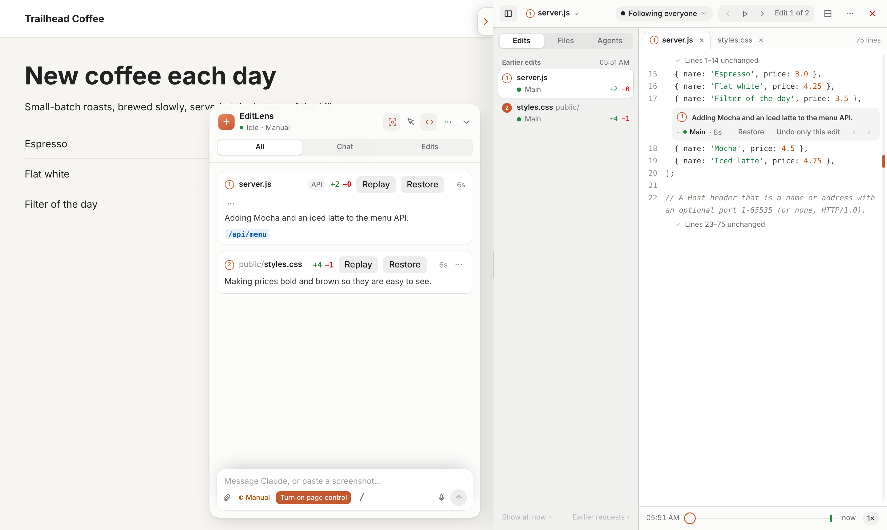

## What you see

- **Highlights on the page.** When Claude changes a file, the parts of the page that changed are highlighted,
  with a label such as `App.jsx:27`.
- **Chat.** Claude's replies, each step Claude takes, and your messages appear in the panel as they happen.
- **Subagents.** Each subagent that Claude starts gets a card with its steps and its result.
- **Server changes.** A change to server code is marked **API**, with the routes it changes. When your page uses
  one of those routes, the parts of the page that the route filled are highlighted in blue.
- **Claude's own highlights.** Claude can draw a dashed outline with a note around any part of the page, to show
  you what it means.
- **Code view.** The code of each change opens beside your page, line by line.
- **Replay.** You can show any change again later. The page highlights its parts again.

| A change shown line by line | Frontend and backend side by side |
| --- | --- |
| 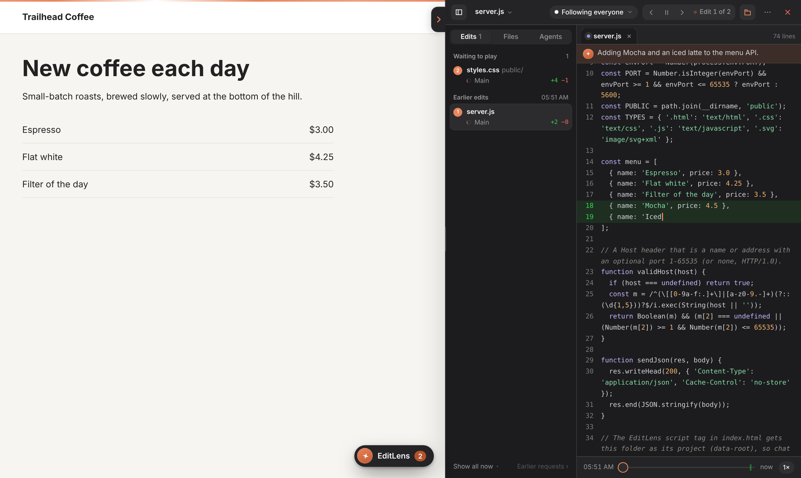 | 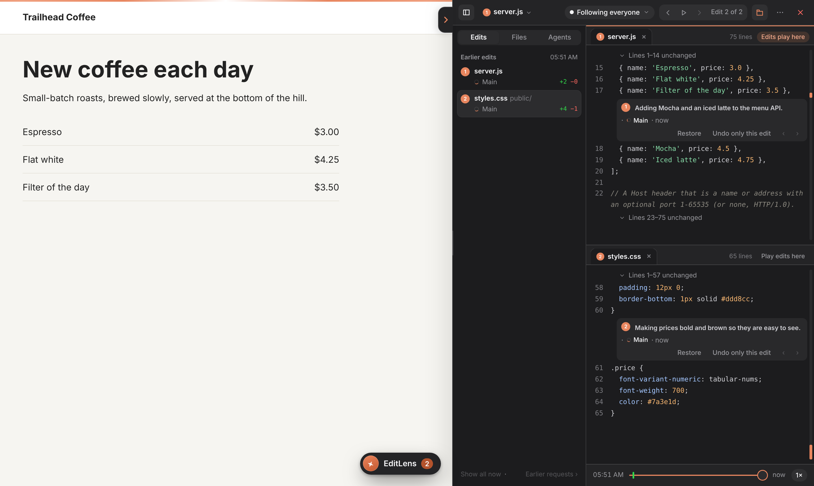 |

The panel uses your light or dark setting. To change its text size or colors, select **More** (`…`) >
**Settings**.

| Dark | Light |
| --- | --- |
| 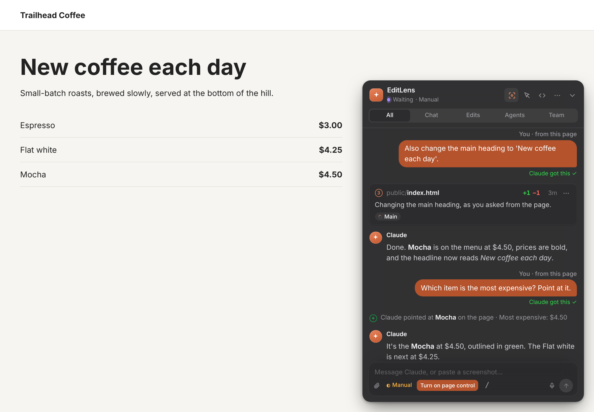 | 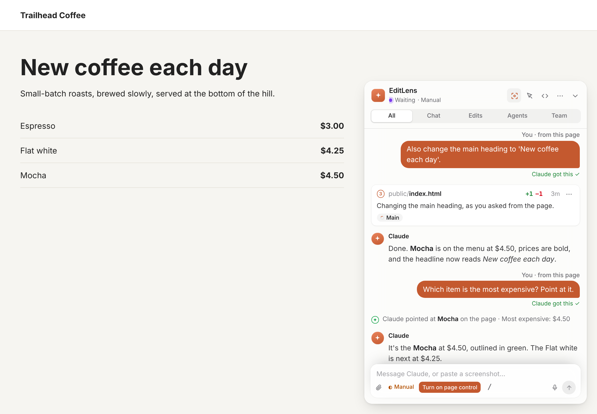 |

## Use the panel

- To send a message to Claude, type in the box at the bottom and press Enter. Press Shift+Enter for a new line.
- To open or minimize the panel, press **Alt+Shift+C**. EditLens remembers your choice.
- To select a part of the page and send it to Claude, press **Alt+Shift+P**. See
  [Select things on the page](pick-box.md).

The header has the main buttons: **Select** (the arrow), **Code view**, **Full screen**, **More** (`…`), and
minimize. **More** has everything else: **Settings**, text size, page highlights, **Wait**, the position of the
panel, and the quick tour.

The tabs **All**, **Chat**, and **Edits** filter the list. The **Agents** and **Team** tabs appear when Claude starts
a subagent. **Team** shows the [team board](subagents.md).

**Keyboard notes:**

- The Alt+Shift keys do nothing while you type in a text field of your own page. On a Mac, Option+Shift+letter
  types a character there.
- On Windows with two keyboard layouts, pressing Alt+Shift alone switches the layout. Press the letter together
  with Alt+Shift.

**Full screen.** The full screen button (four corners) fills the screen with the panel. Press Esc or select the
button again to leave. If the browser doesn't allow full screen, the window grows to the whole screen.

## Ask Claude about EditLens

Claude already knows EditLens, so you can ask in plain words. Some examples:

| You want to | Ask Claude |
| --- | --- |
| Learn the basics | `What can EditLens do here, and which /editlens commands should I use?` |
| See the page | `Connect my page with EditLens and tell me its address.` |
| Show something | `Highlight the signup form on the page and open its code in the code view.` |
| Pair a VPS | `Help me pair this laptop with my VPS through EditLens. Tell me exactly what to type on each computer.` |
| Work on the VPS | `On the VPS, <task>. Wait for it to finish, then show me the diff and merge it if the tests pass.` |
| Check VPS work | `What are my tasks on the VPS doing? Show the last reply of each.` |
| Use two agents | `Split this into two subagents working in their own copies, then merge their changes.` |
| Merge copies | `List the subagent copies with changes and merge the ones that merge without conflicts.` |

In the Claude desktop app, `/editlens ...` may be sent to Claude as a message instead of running as a command.
Claude then runs the command for you, once.

## Change cards and highlights

Each change appears as a card in the panel. Select a card to see what changed.

- The changed parts of the page get a **teal** outline. It stays until you close the card, select another card,
  press Esc, or select **Clear** in the bar at the bottom left.
- **Show** scrolls to the changed part, makes the outline blink, and opens its code in the code view. If several
  parts changed, each click goes to the next one ("showing 2 of 3").
- If the changed part is on another page of your app, the button is **Go to page**. If EditLens doesn't know the
  page yet, the button is **Open code**, and it opens the code instead.
- For a stylesheet change, EditLens highlights the parts of the page that the changed rule styles.
- **Changes** in the bar at the bottom left lists every change in this session, newest first.
- If a change is outside the visible part of the page, a **Claude changed something below** button scrolls to it.

**Colors on the page:**

| Color | Meaning |
| --- | --- |
| Orange | A new change |
| Blue | A change to a server route (API) |
| Teal | What you selected |
| Dashed outline | Claude's own highlight. Select Claude's highlight card to show it again. |

## Code on hover

Move the pointer over a part of the page that Claude changed. After a moment, a card shows the change: old lines
in red, new lines in green. The card shows the file, the line, which agent made the change, and when.

- Select the card to keep it open. Press Esc or select somewhere else to close it.
- The card has **Open in code view**, **Replay**, and **Restore**.
- If a part changed several times, use **‹ 1 of 3 ›** to see each change, newest first.
- A part that Claude removed leaves a dashed **Removed** outline for two minutes. Move the pointer over it to see
  the removed code.
- To turn it off, use the **Show code on hover** setting, or **More** > **Show code on hover**.

## Code view

The code view shows the code of each change beside your page. Removed lines are crossed out. New lines are typed
out one at a time. It opens when Claude changes or opens a file. To open it yourself, select **</>**.

If you close it, it stays closed until your next request. To resize it, drag its left edge. The page moves to
make space.

**Parts of the code view:**

- **Header:** the sidebar button, the file name (select it for the file menu), the **Follow** label, the play
  controls ("Edit 4 of 12"), and **View** (`⋯`).
- **Sidebar:** three tabs. **Edits** lists the changes in this session, grouped by request. **Files** lists the
  open files and the project's folders. **Agents** is the [Agents switcher](subagents.md#agents-switcher). Press
  **Alt+Shift+B** to hide or show the sidebar.
- **File menu:** Open in VS Code, Copy path, Copy code, **Restore…** (puts the file back as it was before this
  request), **Undo only this edit**, **Open in a split**, and Close.
- **Change bar:** above each change. It shows the change number, why it was made, who made it, and when. It has
  **Restore**, **Undo only this edit**, and ‹ › to go to the older or newer change in this file. Lines that didn't
  change are hidden as "Lines 12–80 unchanged". Select that line to show them.
- **Timeline:** at the bottom, with one mark per change. Select or drag to go to a change. The speed button sets
  0.5× to 4×.

**Keys** (while the code view is selected): ← and → go to the previous or next change, Space plays or pauses, and
Esc closes a menu or leaves full screen.

**View menu** (`⋯`): wrap long lines, text size, speed, position (side, bottom, floating, its own window, full
screen, or a narrow bar), Reset, the quick tour, and Settings.

**Tabs and splits.** Each pane has its own row of tabs. A file you open goes to the pane you selected last, which
has a thin blue line over its tabs. Claude's changes go to the pane marked **Edits play here**. To move a tab, drag
it to another pane or use **Open in a split**.

**Make it smaller.** When the code view is on the side, select the arrow on its edge, or press **Alt+Shift+D**, to
make it a narrow bar. The page then uses the full width. Select the bar or press Alt+Shift+D again to open it. The
bar shows how many changes were made while it was small. It opens again for the first change of your next request.
To turn that off, use the **Expand the code view for new requests** setting.

When Claude makes changes faster than the code view shows them, the changes wait in order. **Show all now** shows
them all immediately.

### Follow an agent

The **Follow** label sets whose code you see:

- **Everyone** (default): shows every change.
- **Follow the latest edit:** also opens the files that any agent reads, at the lines it reads.
- **Main** or a subagent's name: shows only that agent's reads and changes.

While you follow an agent, the page follows it too. The page goes to the page of your app that shows the file the
agent is working on, scrolls to that part, and outlines it in the agent's color.

- To get there, EditLens only selects links to another page of your app and tabs. It never selects other buttons.
- EditLens learns which page shows a file as you use your app. It also reads your project's routes (React Router,
  Vue Router, and Next.js `app/` and `pages/`).
- The page waits while you scroll, select, or type, and moves at most every 1.5 seconds. To pause it, select
  **The page follows** in the Follow menu.
- A stylesheet such as `app.css` styles every page, so the page stays where it is. Only a CSS module
  (`*.module.css`) can move the page to its component.
- Files used by the whole app (`main.jsx`, `index`, `layout`) and files that no page shows (server code, JSON)
  don't move the page.
- When more than one Claude makes changes in the same project, each change card shows which one made it.

## Files in Claude's replies

File names in Claude's replies can be selected. They open in the code view, at the lines Claude means. For
example: `[App.jsx](src/App.jsx)`, `` `src/pages` ``, or `src/App.jsx:4-9`.

- A folder opens a list of its files. If a name matches more than one file, EditLens asks which one.
- Web links open in a new tab.
- EditLens shows only files inside the folders Claude Code works in. It doesn't open hidden files (`.env`, `.git`),
  key and password files, binary files, or files larger than 512 KB, and says why.

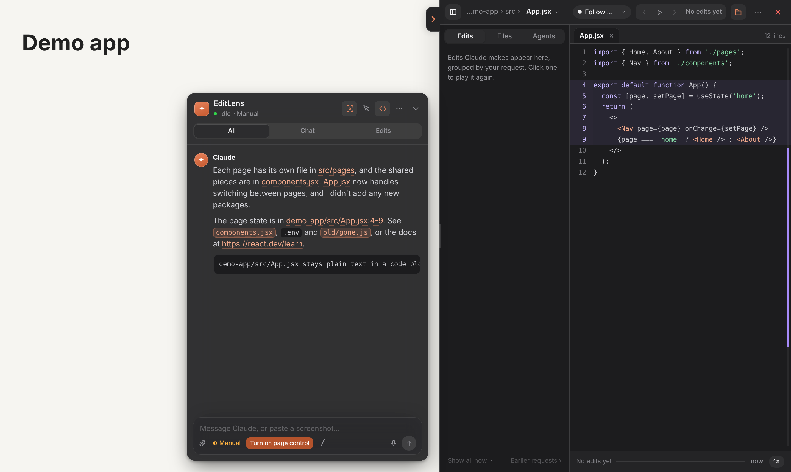

## Commands from the page

To open the command list, press **Ctrl+K** in the panel, **Alt+Shift+K** anywhere on the page, or type `/` in an
empty message box. It lists your custom commands and skills, commands from installed plugins, and Claude Code's
built-in commands.

- **Custom commands and skills** are sent to Claude, which runs them. Add arguments after a space, for example
  `ship staging`.
- **Built-in commands** such as `/compact`, `/clear`, and `/model` work only in Claude Code. The list copies them
  so you can paste them there. Commands marked `disable-model-invocation` work the same way.

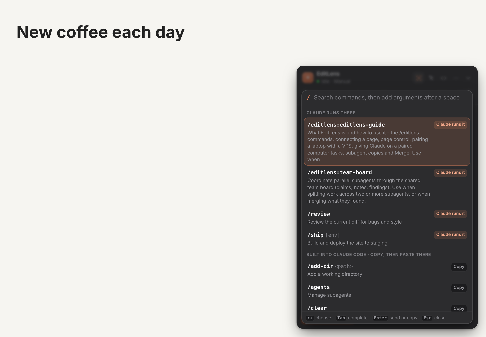

## Usage

Two rings in the panel's header show how much Claude has used. Select them for details: tokens, model, effort,
tool calls, subagents, time, and cost.

- **Context** (teal): how full Claude's context is. The context is how much of the conversation Claude can keep
  in mind at one time.
- **Session** (pink): how much of your plan's 5-hour limit you have used.

Your plan's limits and the exact cost are available only to a Claude Code *status line*, which a plugin can't set
up. To see them, enter `/editlens usage`. It shows the line to add to your `~/.claude/settings.json`. EditLens
never changes that file. Without the status line, the session ring is dashed and shows only the tokens used.

| Transcript only | With Claude Code's status line |
| --- | --- |
| 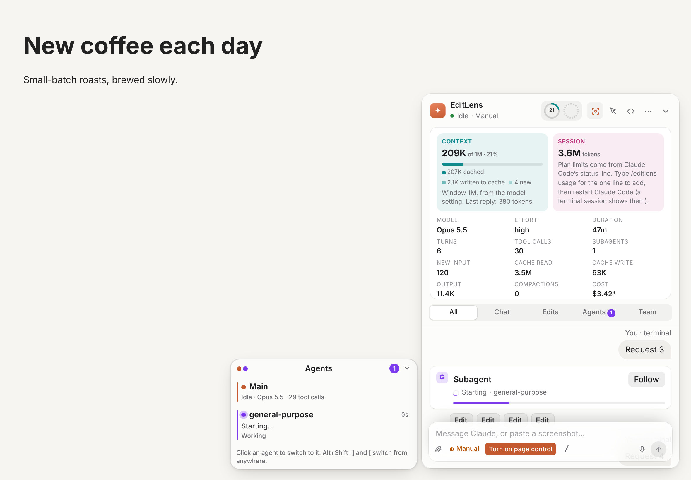 | 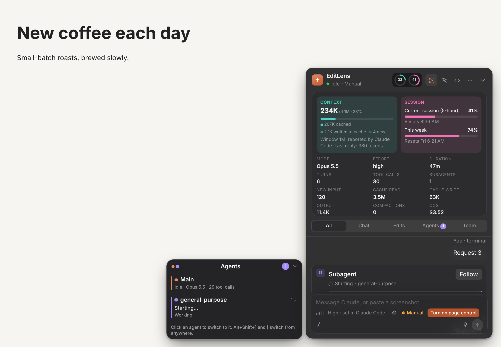 |

How EditLens finds the context size: it uses your auto-compact size if you set one (`/autocompact` or
`CLAUDE_CODE_AUTO_COMPACT_WINDOW`). If not, it uses what Claude Code reports, or your model's size (a model ending
in `[1m]` has 1M). If none of these is known, no size is shown. The details card says which one it
used.

## The EditLens window

You allow Claude's permission questions in the EditLens window, never on your page.

**Why:** Claude can change your page's code. If a page could select **Allow**, Claude could add a line to your
site that selects it. The EditLens window is a separate page of EditLens that your site can't read or select.

- **Allow…** on a card opens the EditLens window. It lists every question that waits. Select **Allow**,
  **Always allow**, or **Deny** there. The window closes when no questions are left.
- **Deny** also works on the card itself.
- To turn on a less strict mode (**Accept edits** or **Bypass permissions**), you confirm in the same window.
- The window's buttons wait a moment after it opens, so a click meant for the page can't select Allow by mistake.
- If the window doesn't open, allow pop-ups for your page, or open `http://127.0.0.1:4317/answer`.

## All permission questions in one list

When a question waits for your answer, a round **permissions button** with a number appears in the top corner of
the page. Select it to see every question, oldest first. Each question shows who asks: Claude, a subagent, or a
task from a paired computer (**◆ name**).

- **Page control and paired computers' tasks:** select **Deny**, or select **Allow…** to answer in the EditLens
  window. **Show in panel** goes to the full card.
- **Questions from Claude Code** (the terminal or the desktop app) are listed so you can see them, but you answer
  them in Claude Code.
- There is no "Allow all".
- To stop the button from being highlighted, turn off **Highlight when Claude waits for you**.

## EditLens in Claude Code

EditLens also shows its status in Claude Code, in the terminal and in the desktop app's Code tab.

**The line above the prompt** shows, in one row:

`✦ ● Page control · Auto   ◆ vps   Working   context ━━──────── 20%   Open  Manual  Details`

It shows questions that wait on the page, Page control or Manual, the paired computer, whether Claude is working,
the context used, subagents, and tokens. In a narrow window, the less important parts are hidden.

- **Open** opens your page with the panel.
- **Manual** or **Page control** switches between them.
- **Details** opens the details, with Disconnect and Settings.
- If the EditLens server stops, the line shows `✕ Not running` with a **Start** button.
- To hide the line, select **Hide line above prompt** in Details, or enter `/editlens line`.

**`/editlens details`** shows everything in one pane: the open pages, the context, tokens for Claude and subagents,
the cost, and every agent with its status. Use the arrow keys to select an agent and see its computer, model,
effort, mode, and start time. Select **Follow** to make your page follow it, or **Stop** to stop it.
`/editlens agents` shows the same list.

**`/editlens sessions`** lists page control's sessions and this project's tasks, on this computer and on paired
computers. For each one, it shows the `claude --resume <id>` command that continues it in Claude Code, and
**Open**, **Stop**, and **Rename**. To stop one by name, enter `/editlens stop <name>`. The panel has the same list
under **More** > **Sessions**.

The first time you start Claude Code with EditLens, one line tells you to enter `/editlens`. After that, nothing is
shown at start.

This part of EditLens is a Claude Code mod (`hooks/mod.mjs`). This is why EditLens needs Claude Code 2.1.287 or
later (2.1.286 in the desktop app).

## Move the panels

- **Move:** drag the panel or the code view by its title. Release it near an edge to dock it. The code view docks
  left, right, or at the bottom. The panel moves to the nearest corner. A dashed outline shows where it will go.
- **Resize:** drag the corner of a floating window. A docked code view resizes from its inner edge.
- **More** (`…`) in the panel and **View** (`⋯`) in the code view have the same options, and also:
  - **Pop out into its own window**, for a second monitor. In Chrome and Edge, the window stays above other
    windows. In other browsers, allow pop-ups for your site. To close it, close the window or select **Back to the
    page**. Reloading the page closes these windows.
  - **Full screen**.
  - **Reset layout** puts both panels back where they started.

EditLens remembers positions and sizes for each site. If the browser window gets smaller or moves to another
monitor, the panels move back into view.

To see the feed on its own page, open `http://127.0.0.1:4317/`.

## More pictures

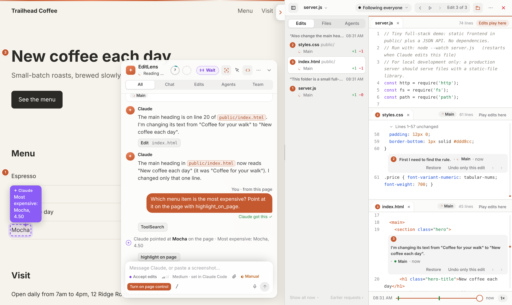

| Subagents | Server change, and a message sent from the page |
| --- | --- |
| 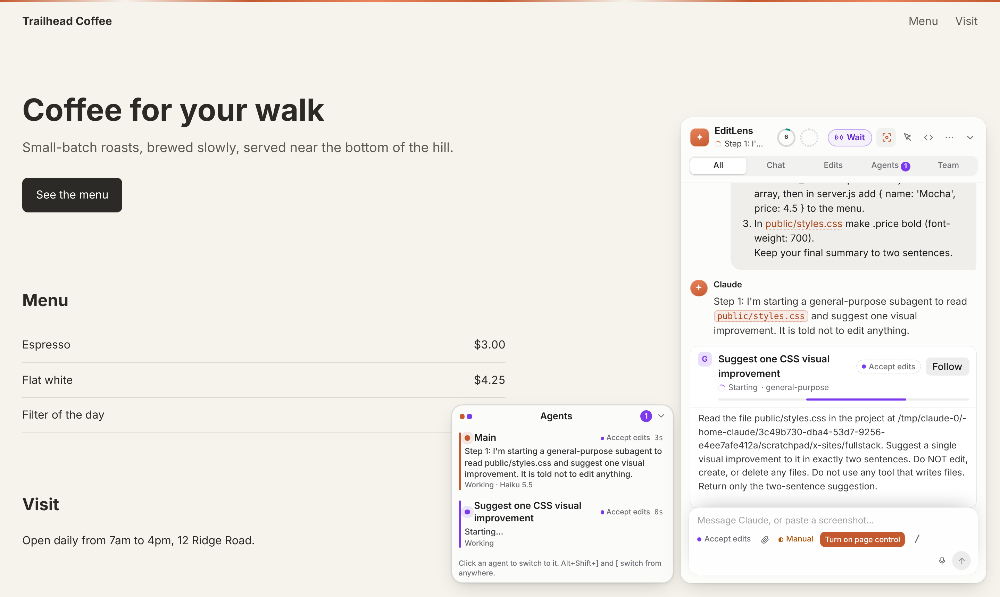 | 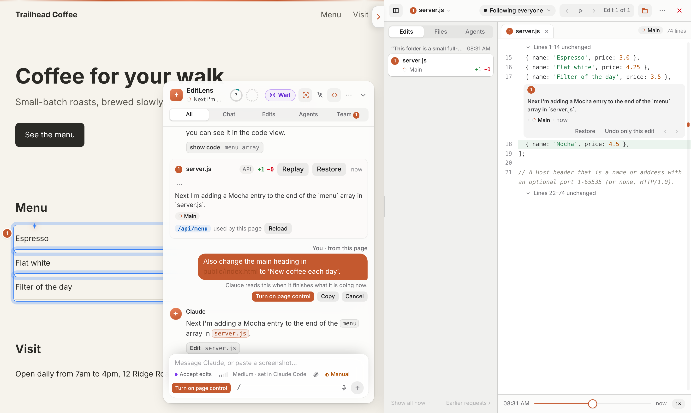 |

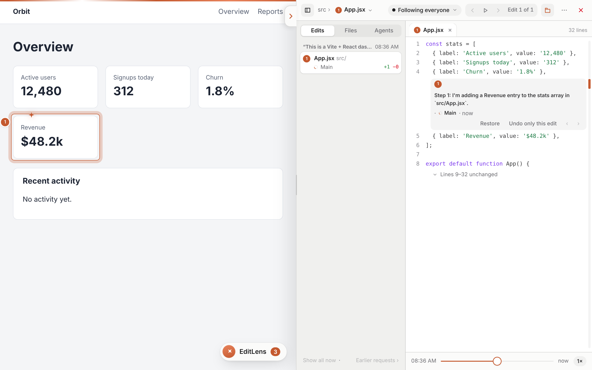

| Plain HTML page | Vite and React |
| --- | --- |
| 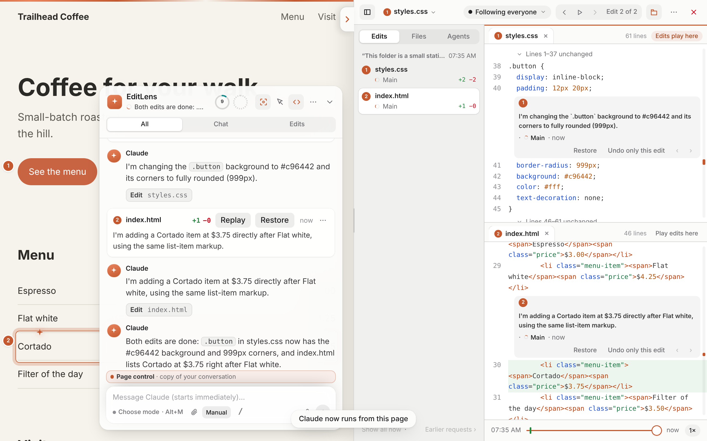 | 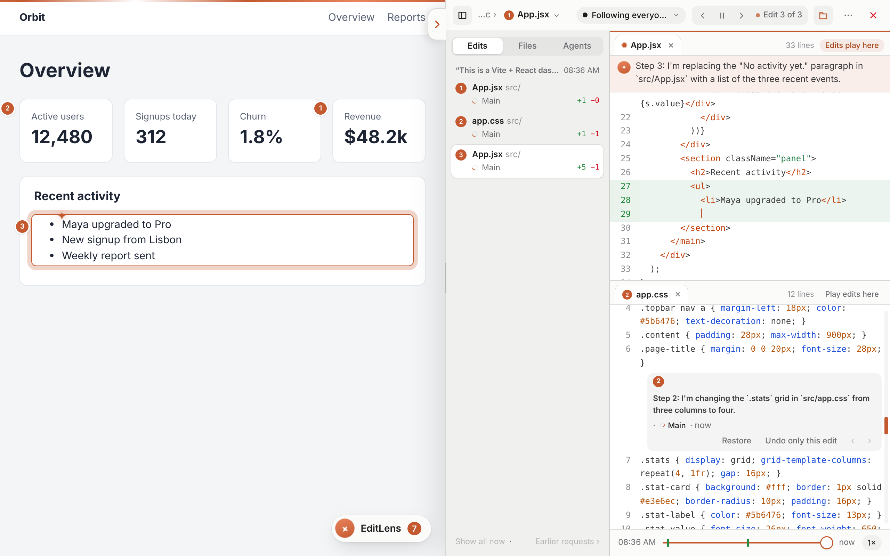 |
| 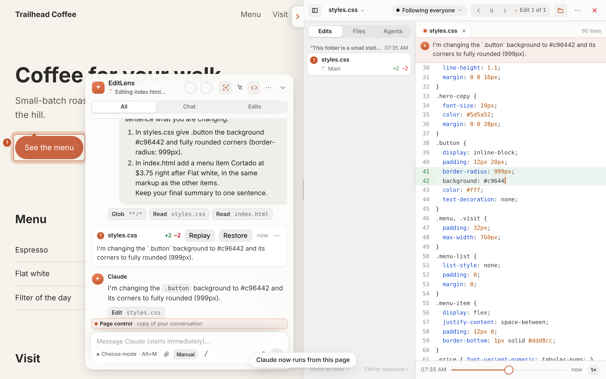 | 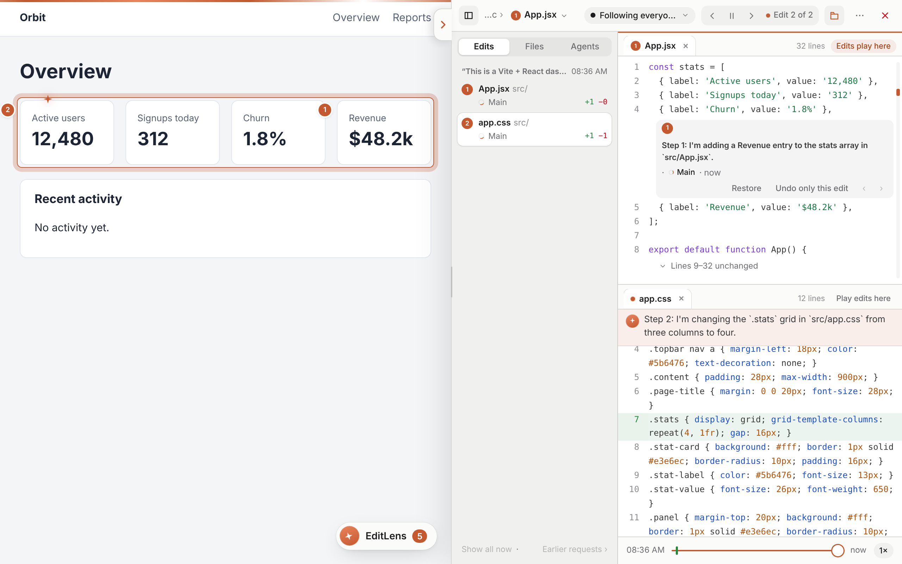 |
