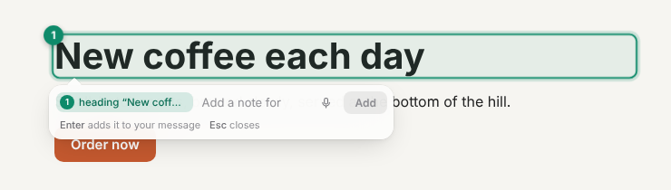
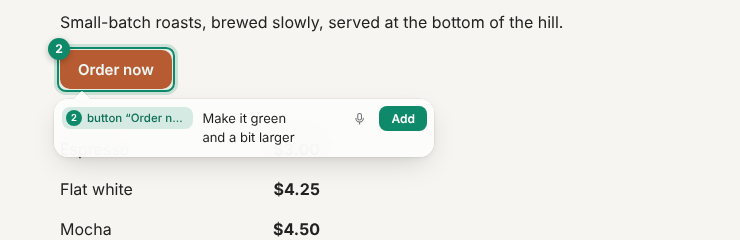
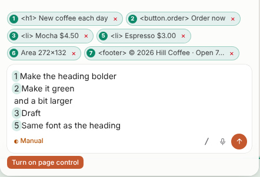
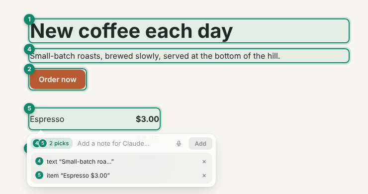
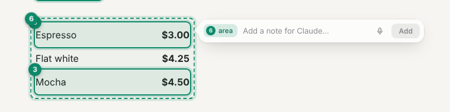
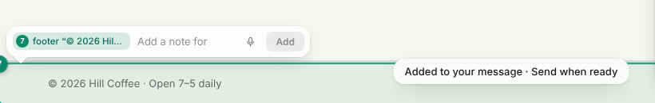
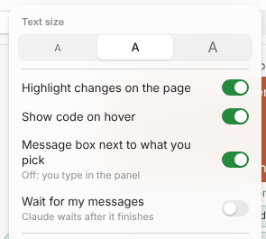

# Select things on the page

Select a part of the page to show Claude exactly what you mean. You don't need to describe it in words.

## Select a part of the page

1. Press **Alt+Shift+P**, or select the arrow button in the panel header.
2. Move the pointer over the page. EditLens outlines each part and shows where it is in the code, for example
   `StatCard · App.jsx:9`.
3. Select a part. To select several parts, hold Shift while you select. To select an area, drag a box.
4. Type your message and select **Send**. The message can be empty.

Press **Esc** to stop selecting.

Each selected part gets a green number on the page and a label above the message box. Select a label to scroll to
it, or × to remove it.

**Select code.** In the code view, select some lines, and then select **Attach lines… for Claude**.

**Add images.** Paste a screenshot into the message box, or select **Attach** (the paperclip) to choose PNG, JPEG,
or WebP files. You can add up to 3 images per message, 5 MB each.

**Add a note next to it.** After you select a part, a small message box opens next to it. See
[A note next to what you pick](#a-note-next-to-what-you-pick).

### What Claude gets

For each number, Claude gets the source file and line, the component, the visible text, a selector, the size and
position, and a few styles. For code, Claude gets the lines themselves.

Claude can highlight the same numbers in its answer (`highlight_on_page` with `{ "marker": 2 }`).

### Where the file and line come from

EditLens uses the best source it can find:

1. **Vite with JSX or TSX:** the Vite plugin tags each element with its file and line
   (`data-editlens-src="src/App.jsx:9:5"`), during `vite dev` only. It uses your project's own `@babel/core`, which
   `@vitejs/plugin-react` installs. To turn it off, use `editlens({ source: false })`.
2. **React 18:** React's development information. In Vite apps without the tag, the line numbers can be wrong, so
   Claude is told to find the element in the file.
3. **React 19, Vue, and Svelte:** the component's file. Svelte also gives the line.
4. **Other sites:** the component name, text, and selector. These are usually enough to find the code.

## A note next to what you pick

After you select something on the page, a small message box opens next to it. Type what you want
changed there; **Add** puts it in the panel's message box, where you send it. Nothing is sent from
the small box.

### Step 1. Pick something

Select the arrow button in the panel (or press **Alt+Shift+P**), and then select a part of the page. It gets a green number,
and the box opens just below it, pointing at it. It names what you picked.

### Step 2. Type a note

**Shift+Enter** starts a new line. You can also use the mic: [docs/dictation.md](dictation.md).

### Step 3. Add it to your message

Press **Add** or **Enter**. The note goes into the panel's message box on its own line, after the
pick's number ("1 Make the heading bolder"); the number is marked in green. Nothing is sent: change
the message if you like, then press **Send**.

### More than one item

Hold Shift and select more items before you type, to write one note for all of them. The box shows how many.
Move the pointer over it to see the list. Select × to remove one.

A dragged area gets the box beside it. Near the bottom of the window the box opens above the item.
Select an item you picked before to open the box again and add another note.

### Closing it

Press **Esc** or select somewhere else to close the box. What you typed is kept in the panel's message box. On
phones and narrow windows, you type in the panel's message box instead.

### The setting

To turn the box off, select **More** (`…`) > **Message box next to what you pick**, or use Settings. You then type
in the panel.

